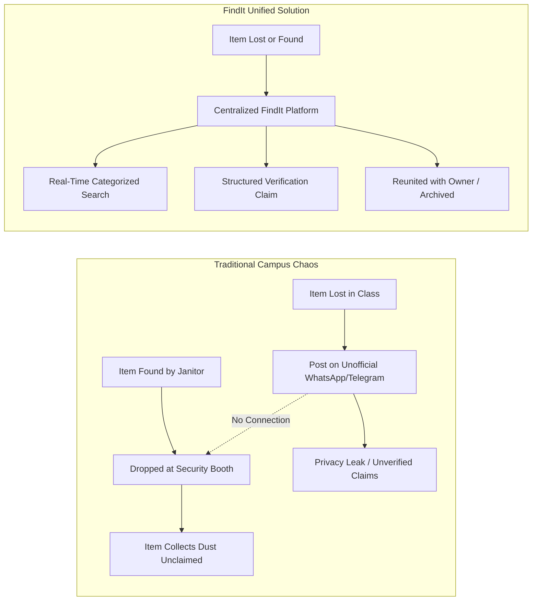
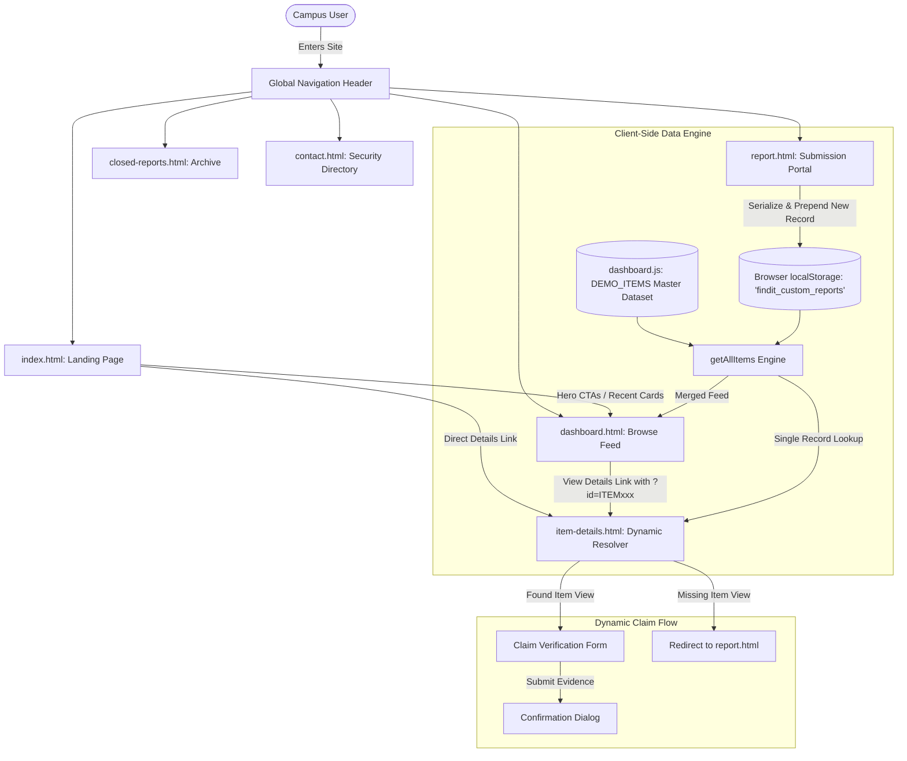
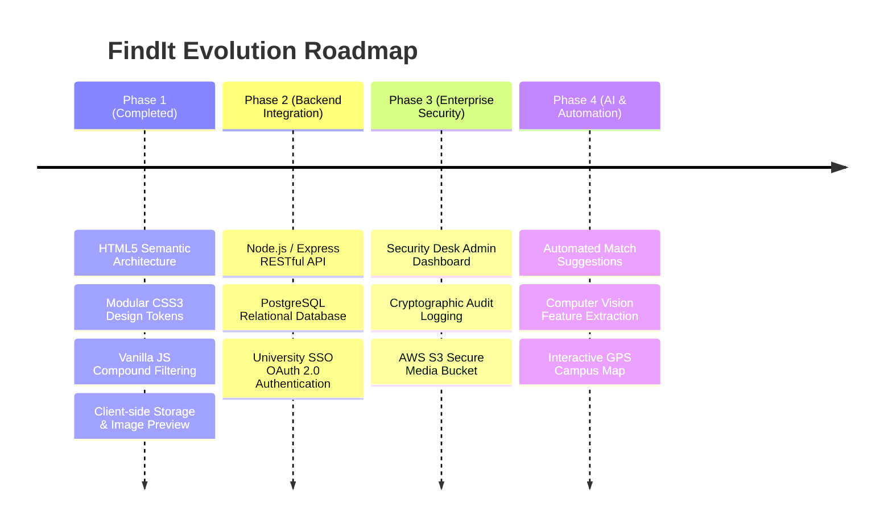

# Project Documentation & Technical Report
## FindIt – Lost & Found Campus Platform

> **Tagline:** *"Lost Something? Find It. Found Something? Return It."*  
> **Course / Academic Level:** College Web Development Capstone / Semester Project  
> **Author / Developer:** Akshit  
> **Version:** 1.0.0 (Production-Ready Prototype)  
> **Last Updated:** November 2026  

---

## Table of Contents
1. [Executive Summary & Abstract](#1-executive-summary--abstract)
2. [Project Aim & Theoretical Foundations](#2-project-aim--theoretical-foundations)
   - 2.1 The Campus Problem Space
   - 2.2 Core Project Aim & Objectives
   - 2.3 Theoretical Foundations of Lost & Found Systems
3. [Technology Stack & Architectural Rationale](#3-technology-stack--architectural-rationale)
   - 3.1 Technology Matrix
   - 3.2 Pedagogical & Architectural Constraints
   - 3.3 Design System & Visual Theory
4. [System Architecture & Data Engineering](#4-system-architecture--data-engineering)
   - 4.1 High-Level Architecture Diagram
   - 4.2 Entity Schema & Data Structures
   - 4.3 Data Lifecycle & State Persistence
5. [Detailed Module & Page Breakdown](#5-detailed-module--page-breakdown)
   - 5.1 Landing Page (`index.html`)
   - 5.2 Multi-Facet Dashboard (`dashboard.html`)
   - 5.3 Dual Reporting Portal (`report.html`)
   - 5.4 Dynamic Item Details & Claim Engine (`item-details.html`)
   - 5.5 Public Recovery Archive (`closed-reports.html`)
   - 5.6 Campus Security & Help Center (`contact.html`)
6. [Core Algorithms & Technical Deep Dive](#6-core-algorithms--technical-deep-dive)
   - 6.1 Compound Multi-Facet Filtering Engine
   - 6.2 URL Parameter Dynamic Routing & ID Normalization
   - 6.3 In-Memory Binary File Processing (`FileReader` API)
   - 6.4 Client-Side State Synchronization (`localStorage` Engine)
7. [Current Prototype vs. Future Production Roadmap](#7-current-prototype-vs-future-production-roadmap)
   - 7.1 Gap Analysis Matrix
   - 7.2 Scalable Multi-Phase Production Plan
8. [Testing, Responsive Verification & Quality Assurance](#8-testing-responsive-verification--quality-assurance)
   - 8.1 Viewport Breakpoint Testing
   - 8.2 Functional Verification Matrix
9. [Viva Voce & Technical Defense Preparation](#9-viva-voce--technical-defense-preparation)
   - 9.1 Fundamental Technical Concepts
   - 9.2 Anticipated Viva Questions & Model Answers
10. [Conclusion & Academic References](#10-conclusion--academic-references)

---

## 1. Executive Summary & Abstract

Campus environments are densely populated micro-cities where thousands of students, faculty members, and operational personnel traverse lecture halls, specialized laboratories, libraries, athletic centers, and dining facilities daily. Due to frequent room transitions, commuter transit, and high physical activity, personal belongings—including costly electronics, student identification credentials, proprietary notebooks, calculators, keys, and wallets—are routinely misplaced.

Traditional campus recovery relies on fragmented, ad-hoc mechanisms: broadcast messages on unofficial social media groups, handwritten flyers affixed to physical bulletin boards, and unorganized physical repository bins at departmental security booths. These legacy methods exhibit severe deficiencies:
- **Low Discovery Rates:** Lost belongings remain unclaimed simply because finders and losers lack a shared communication channel.
- **Privacy Vulnerabilities:** Desperate owners publicly post private phone numbers and email addresses on open social channels.
- **Zero Accountability:** Physical turn-in stations rarely maintain digital custody logs, inviting false claims and ownership disputes.

**FindIt** resolves these challenges by introducing a centralized, client-side digital Lost & Found web platform engineered specifically for collegiate institutions. Built purely using native **HTML5**, **CSS3**, and **Vanilla JavaScript (ES6+)**, FindIt delivers real-time search, multi-faceted filtering, a dual reporting interface with local image previewing, dynamic query-based detail routing, and a privacy-preserving ownership verification protocol. The platform demonstrates that enterprise-grade UI/UX, responsive geometry, and interactive state management can be achieved without heavy JavaScript frameworks or external dependencies.

---

## 2. Project Aim & Theoretical Foundations

### 2.1 The Campus Problem Space



### 2.2 Core Project Aim & Objectives

The primary aim of **FindIt** is to provide an accessible, intuitive, and trustworthy digital bridge between individuals who have lost belongings and individuals or campus authorities who have recovered them.

#### Specific Measurable Objectives:
1. **Centralize Campus Reporting:** Eliminate fragmented communication channels by establishing a single, authoritative digital portal for all campus departments.
2. **Accelerate Item Reconnection:** Provide sub-second keyword search and multi-dimensional filtering (Status, Category, Campus Building, Date).
3. **Preserve User Privacy:** Eliminate public phone broadcasting; replace it with an institutional ownership claim mechanism that verifies distinguishing features before disclosing contact details.
4. **Ensure Device Ubiquity:** Guarantee 100% responsive fluid rendering across desktop monitors, tablet computers, and handheld mobile screens down to 375px width.
5. **Demonstrate Web Standards Mastery:** Construct the entire application strictly with native browser technologies, prioritizing semantic accessibility, modular architecture, and zero build tool overhead.

### 2.3 Theoretical Foundations of Lost & Found Systems

The platform’s architectural decisions are rooted in human-computer interaction (HCI) and information retrieval principles:

#### A. Information Foraging Theory (Pirolli & Card)
Users seeking missing possessions experience high anxiety and cognitive load. The UI must provide strong "information scent"—clear visual badges, immediate photographic recognition, and unambiguous breadcrumbs. FindIt incorporates high-contrast status tags (Burnt Amber for *Missing*, Emerald Teal for *Found*, Slate Grey for *Recovered*) so users can parse item status in milliseconds.

#### B. Nielsen’s Usability Heuristics
- **Visibility of System Status:** Live KPI counters immediately communicate the aggregate volume of active missing items, surrendered found items, and successfully closed cases.
- **Match Between System and Real World:** Terminology reflects campus life (e.g., *Academic Block 3*, *Physics Lab 204*, *Central Library*).
- **Error Prevention & Graceful Fallbacks:** If a search query yields zero matches, an empty state card appears with an instant "Clear All Filters" trigger, preventing dead ends.

#### C. The Ownership Verification Protocol (Two-Phase Claiming)
In physical property law, custody transfer requires verification of title. Rather than displaying open contact details, FindIt implements an asynchronous verification model:
1. **Public Listing (Phase 1):** General features (e.g., "Black Wireless Earbuds, Library") are public.
2. **Claim Submission (Phase 2):** Claimants must answer targeted verification prompts (e.g., serial number fragment, unique scratches, engraving, lock screen image).
3. **Physical Custody Handover (Phase 3):** Campus Security verifies the submitted claim evidence against the physical object before closing the ticket.

---

## 3. Technology Stack & Architectural Rationale

### 3.1 Technology Matrix

| Layer | Technology | Version | Purpose in FindIt |
| :--- | :--- | :--- | :--- |
| **Markup** | HTML5 | Standard W3C | Semantic document outline, accessible forms, native input validations, dialog containers. |
| **Styling** | CSS3 | Native Spec | Design tokens (`:root`), Flexbox, CSS Grid, glassmorphism, responsive breakpoints. |
| **Scripting** | Vanilla JavaScript | ECMAScript 2020+ | DOM manipulation, compound search engine, `URLSearchParams`, `FileReader`, `localStorage`. |
| **Icons & Assets** | PNG / SVG | Optimized Web Formats | High-contrast category and navigation icons, campus photography, visual badge illustrations. |
| **Storage (Prototype)** | Web Storage API | `localStorage` | Client-side persistence of user-submitted reports across browser sessions. |

### 3.2 Pedagogical & Architectural Constraints

To adhere to rigorous academic web development standards, the following technical constraints were strictly enforced:

- ❌ **No UI Frameworks:** No React, Vue, Angular, or Svelte. All DOM nodes are rendered, updated, and removed via native JavaScript (`document.createElement`, `innerHTML`, `querySelector`).
- ❌ **No CSS Frameworks:** No Bootstrap, Tailwind CSS, or Bulma. Every utility class, grid system, button state, and animation is custom-authored.
- ❌ **No Helper Libraries:** No jQuery, Lodash, or Axios. Native browser APIs (`Array.prototype.filter`, `addEventListener`, `URLSearchParams`) perform all operations.
- ❌ **No Backend Runtime:** No Node.js, Express, Django, Flask, or PHP.
- ❌ **No Database Engines:** No MySQL, MongoDB, or Firebase.
- ❌ **Zero Build Step:** Runs instantly in any standard web browser by opening `index.html` directly or via any lightweight static web server.

### 3.3 Design System & Visual Theory

FindIt implements a **fixed light professional theme** tailored for institutional credibility and readability.

```css
:root {
  /* Brand Tokens */
  --primary: #2563EB;          /* Royal Blue: Primary action, focus states */
  --primary-dark: #1D4ED8;     /* Deep Navy-Blue: Hover states */
  --primary-light: #EFF6FF;    /* Ice Blue: Active pill backgrounds */
  
  /* Canvas Tokens (Fixed Light Theme) */
  --background: #F8FAFC;       /* Off-White / Slate 50: Non-glare canvas */
  --surface: #FFFFFF;          /* Pure White: Cards, modals, containers */
  --surface-soft: #F1F5F9;     /* Light Gray: Secondary inputs, table headers */
  
  /* Typography Tokens */
  --navy: #0F172A;             /* Slate 900: High-contrast headings */
  --text-primary: #1E293B;     /* Slate 800: High-readability body copy */
  --text-secondary: #64748B;   /* Slate 500: Subtitles, metadata, timestamps */
  
  /* Semantic Badges */
  --danger: #DC2626;           /* Crimson: 'Missing' status badge */
  --success: #16A34A;          /* Emerald: 'Found' status badge */
  --info: #0284C7;             /* Sky Blue: Informational badges */
  --border: #E2E8F0;           /* Crisp component perimeter lines */
}
```

#### Visual Styling Principles:
- **8-Point Spatial Grid:** All margins, paddings, gap utilities, and button heights conform strictly to multiples of 8px (`8px`, `16px`, `24px`, `32px`, `48px`, `64px`), eliminating visual dissonance.
- **Restrained Glassmorphism:** Navigation headers and modal backdrops utilize `backdrop-filter: blur(12px)` combined with semi-opaque white backgrounds (`rgba(255, 255, 255, 0.85)`), providing modern tactile depth without compromising legibility.
- **No Dark Mode Gimmick:** Institutional platforms prioritize consistency and WCAG AAA contrast ratios. A single, refined light theme ensures identical visual clarity across all devices.

---

## 4. System Architecture & Data Engineering

### 4.1 High-Level Architecture Diagram



### 4.2 Entity Schema & Data Structures

Every lost or found item is modeled as a standardized JSON object. This structure guarantees seamless serialization between static arrays, `localStorage`, and DOM rendering templates:

```typescript
interface CampusItem {
  id: string;               // Unique primary key (e.g., 'ITEM001' or 'ITEM-CUSTOM-1732450000')
  name: string;             // Descriptive title of the object
  status: 'missing' | 'found' | 'recovered'; // Current lifecycle state
  category: string;         // 'electronics' | 'id-cards' | 'bags' | 'stationery' | 'accessories' | 'clothing' | 'keys'
  location: string;         // Standardized campus building or zone name
  date: string;             // ISO-like or formatted date string (e.g., 'Oct 14, 2026')
  description: string;      // Comprehensive physical description
  features?: string;        // Distinguishing markings, scratches, stickers, or contents
  image: string;            // File path or Base64 Data URL
  contact?: string;         // Optional masked contact email
  claimStatus?: string;     // 'Unclaimed' | 'Under Verification' | 'Resolved'
}
```

### 4.3 Data Lifecycle & State Persistence

1. **Initialization:** On first load, `dashboard.js` initializes with `DEMO_ITEMS`, an array of 14 realistic campus items.
2. **Submission:** When a user submits a report on `report.html`, JavaScript validates the inputs, reads the selected image file as a Base64 string, constructs a new `CampusItem` object, and prepends it to the `findit_custom_reports` array in `localStorage`.
3. **Hydration & Merge:** When `dashboard.html` or `item-details.html` loads, `getAllItems()` retrieves the static array, executes `JSON.parse(localStorage.getItem('findit_custom_reports'))`, and concatenates them, placing user-created reports at the top of the feed.

---

## 5. Detailed Module & Page Breakdown

### 5.1 Landing Page (`index.html`)
- **Hero Banner:** Bold typography (*"Lost Something? Find It. Found Something? Return It."*) with dual call-to-action buttons directing users to either locate or report belongings.
- **Hero Visual Composition:** An arrangement showing common campus belongings (backpack, water bottle, calculator, earbuds) surrounded by floating glassmorphic status badges.
- **How FindIt Works:** A 3-step structured visual guide explaining the recovery lifecycle: *Report*, *Discover*, and *Reconnect*.
- **Recently Reported Feed:** Displays 6 live item cards linked directly to `item-details.html?id=ITEM001` through `ITEM006`.
- **Institutional Trust Pillars:** Four cards highlighting privacy preservation, campus security oversight, verified ownership, and unified departmental tracking.

### 5.2 Multi-Facet Dashboard (`dashboard.html`)
- **Metric KPI Summary:** Four live stat cards tracking *Total Reports*, *Active Missing*, *Surrendered Found*, and *Successfully Recovered*.
- **Search Bar:** Real-time client-side keyword search across item titles, categories, descriptions, and campus locations.
- **Filter Toolbar:**
  - Status pill buttons: *All Items*, *Missing*, *Found*.
  - Category dropdown: *Electronics*, *ID & Documents*, *Bags*, *Books & Stationery*, *Keys*, *Clothing*, *Accessories*.
  - Campus Location dropdown: *Central Library*, *Academic Block*, *Cafeteria*, *Sports Complex*, *Labs*, *Hostels*.
  - Date sorting: *Newest First*, *Oldest First*.
- **Item Grids:** Dual responsive grid containers cleanly separating active missing cases from surrendered found property.
- **Empty State Fallback:** An interactive graphic and "Clear All Filters" trigger displayed automatically when query parameters return zero matches.

### 5.3 Dual Reporting Portal (`report.html`)
- **Interactive Type Selector:** Segmented radio cards allowing users to choose between reporting a *Missing Item* or a *Found Item*. Selection dynamically updates form accent borders and status indicators.
- **Standardized Metadata Fields:** Item name, category selection, campus location selector, incident date picker, color, distinguishing marks, and optional contact info.
- **Client-Side Image Dropzone:** Uses an HTML5 file input with an attached `FileReader` listener, presenting an instant image preview box before submission without uploading to an external server.
- **Confirmation Modal:** Displays an animated success dialog upon submission, giving the user an instant one-click route to view their report live on the dashboard.

### 5.4 Dynamic Item Details & Claim Engine (`item-details.html`)
- **Query Parameter Extraction:** Inspects `window.location.search` for `?id=ITEMxxx` and matches against the master dataset.
- **Item Not Found View:** If an invalid or nonexistent ID is passed in the URL, the page renders a polite warning card with a direct button back to the dashboard.
- **Custody & Verification Timeline:** A step-by-step progress indicator showing the item's path from *Reported* &rarr; *Custody Secured* &rarr; *Claim Under Review* &rarr; *Returned*.
- **Contextual Claim Box:**
  - If the item is **Found**: Renders the "Claim This Item" form requesting claimant identity and proof of ownership.
  - If the item is **Lost**: Renders a helpful notification: *"Have you found this item? Help the owner by reporting it as found."*

### 5.5 Public Recovery Archive (`closed-reports.html`)
- **Transparency Feed:** Displays 6 successfully recovered items, celebrating successful reunions and proving platform efficacy.
- **Summary Counters:** Metrics highlighting closed case counts and average recovery turnaround.
- **Privacy Enforcement:** Displays item photos and recovery locations while strictly withholding personal claimant names and phone numbers.

### 5.6 Campus Security & Help Center (`contact.html`)
- **Physical Desk Directory:** Exact room numbers, operating hours, and internal phone extensions for Central Security, Academic Block Security, and the Sports Center Desk.
- **Standard Operating Procedures (SOP):** Instructions on what to do when discovering valuable property on campus.
- **Interactive FAQ Accordion:** Common questions addressing claim timelines, uncollected property policies, and verification criteria.
- **Direct Inquiry Form:** Client-side form with a submission confirmation modal.

---

## 6. Core Algorithms & Technical Deep Dive

### 6.1 Compound Multi-Facet Filtering Engine
Traditional web applications often trigger server round-trips for search queries. FindIt executes all filtering in-memory within the client's browser, providing sub-millisecond response times:

```javascript
// Located in js/dashboard.js
function filterItems() {
  const query = searchInput.value.trim().toLowerCase();
  const currentStatus = activeStatusFilter; // 'all' | 'missing' | 'found'
  const currentCategory = categorySelect.value;
  const currentLocation = locationSelect.value;
  const currentSort = sortSelect.value;

  const allItems = getAllItems();

  const filtered = allItems.filter(item => {
    // 1. Status Match
    const matchesStatus = (currentStatus === 'all') || (item.status === currentStatus);
    
    // 2. Category Match
    const matchesCategory = (currentCategory === 'all') || (item.category === currentCategory);
    
    // 3. Location Match
    const matchesLocation = (currentLocation === 'all') || (item.location === currentLocation);
    
    // 4. Keyword Substring Match across multiple attributes
    const matchesSearch = (query === '') ||
      item.name.toLowerCase().includes(query) ||
      item.category.toLowerCase().includes(query) ||
      item.location.toLowerCase().includes(query) ||
      item.description.toLowerCase().includes(query);

    return matchesStatus && matchesCategory && matchesLocation && matchesSearch;
  });

  // Sorting
  filtered.sort((a, b) => {
    const dateA = new Date(a.date);
    const dateB = new Date(b.date);
    return currentSort === 'newest' ? dateB - dateA : dateA - dateB;
  });

  renderGrids(filtered);
}
```

### 6.2 URL Parameter Dynamic Routing & ID Normalization
Rather than building separate static HTML pages for every item, `item-details.html` serves as a dynamic page template using native URL parsing:

```javascript
// Located in js/item-details.js
function getItemIdFromUrl() {
  const urlParams = new URLSearchParams(window.location.search);
  let id = urlParams.get('id');
  if (!id) return null;

  id = id.trim().toUpperCase();

  // Normalize numeric or shorthand queries: e.g., '1' -> 'ITEM001'
  if (/^\d+$/.test(id)) {
    id = 'ITEM' + id.padStart(3, '0');
  }
  return id;
}
```

### 6.3 In-Memory Binary File Processing (`FileReader` API)
To allow students to preview images locally without needing an image hosting server or cloud bucket:

```javascript
// Located in js/forms.js
imageInput.addEventListener('change', function(e) {
  const file = e.target.files[0];
  if (file && file.type.startsWith('image/')) {
    const reader = new FileReader();
    reader.onload = function(event) {
      previewImg.src = event.target.result; // Base64 Data URL
      previewContainer.style.display = 'block';
    };
    reader.readAsDataURL(file);
  }
});
```

### 6.4 Client-Side State Synchronization (`localStorage` Engine)
```javascript
// Located in js/dashboard.js & js/forms.js
function getAllItems() {
  const customItemsJson = localStorage.getItem('findit_custom_reports');
  let customItems = [];
  if (customItemsJson) {
    try {
      customItems = JSON.parse(customItemsJson);
    } catch (e) {
      console.error('Failed to parse localStorage reports', e);
    }
  }
  // Custom user reports appear first, followed by baseline demonstration items
  return [...customItems, ...DEMO_ITEMS];
}
```

---

## 7. Current Prototype vs. Future Production Roadmap

### 7.1 Gap Analysis Matrix

| Feature Domain | Current Prototype Implementation | Full-Scale Production Target |
| :--- | :--- | :--- |
| **Data Storage** | Browser `localStorage` (Isolated to client machine) | Distributed relational database (PostgreSQL on AWS RDS) |
| **Authentication** | Simulated identity; optional contact field | University OAuth 2.0 / SAML Single Sign-On (`@campus.edu`) |
| **Image Storage** | In-memory Base64 Data URLs | AWS S3 Bucket with CloudFront CDN & automated resizing |
| **Claim Verification** | Client-side modal dialog with local storage log | Role-Based Access Control (RBAC) portal for Campus Security |
| **Notifications** | Static confirmation alert modals | Automated email & SMS push alerts via SendGrid / Twilio |
| **Location Mapping** | Dropdown campus building tags | Interactive Leaflet.js / OpenStreetMap floor-by-floor map |
| **Image Matching** | Manual visual inspection by users | Computer Vision (TensorFlow / OpenCV) similarity scoring |

### 7.2 Scalable Multi-Phase Production Plan



---

## 8. Testing, Responsive Verification & Quality Assurance

### 8.1 Viewport Breakpoint Testing

Layout stability was validated across standard device widths:
- **Desktop (1440px):** 4-column balanced card grid, expanded navigation menu, side-by-side hero composition. No horizontal scrollbar (`overflow-x: hidden`).
- **Laptop / Tablet Landscape (1024px):** 3-column card grid, automatic wrap on filter toolbars.
- **Tablet Portrait (768px):** 2-column card grid, navigation transitions to mobile hamburger button, form controls stack into unified vertical rows.
- **Mobile Handheld (375px):** 1-column layout, touch-friendly 44px minimum tap targets, slide-out drawer menu with escape key and backdrop dismiss.

### 8.2 Functional Verification Matrix

| Test Case | Procedure | Expected Outcome | Result |
| :--- | :--- | :--- | :--- |
| **TC-01: Multi-Filter** | Select "Electronics" + "Central Library" + type "Earbuds" | Only `ITEM001` matches; other cards hide instantly. | **Pass** |
| **TC-02: Zero-Result State** | Type "Unobtainium" in search bar | Both grids hide; `#emptyState` card appears with reset button. | **Pass** |
| **TC-03: Reset Filters** | Click "Clear All Filters" in empty state | Search input clears; all 14 cards reappear. | **Pass** |
| **TC-04: Dynamic Detail Route** | Navigate to `item-details.html?id=ITEM003` | Renders Student ID Card, cafeteria location, and custody trail. | **Pass** |
| **TC-05: Padded Numeric ID** | Navigate to `item-details.html?id=5` | Normalizes to `ITEM005` (Scientific Calculator). | **Pass** |
| **TC-06: Invalid ID Fallback** | Navigate to `item-details.html?id=INVALID999` | Displays "Item not found" card with return link. | **Pass** |
| **TC-07: Image Preview** | Select JPG in `report.html` | File reader triggers; image renders in preview container. | **Pass** |
| **TC-08: Report Persistence** | Submit new item, navigate to `dashboard.html` | Custom item appears at the top of the corresponding grid. | **Pass** |

---

## 9. Viva Voce & Technical Defense Preparation

### 9.1 Fundamental Technical Concepts

1. **Document Object Model (DOM):** The tree-structured programmatic representation of the HTML document. JavaScript manipulates this tree via methods like `.getElementById()`, `.querySelector()`, and `.appendChild()`.
2. **Event Delegation:** Rather than attaching event listeners to dozens of individual cards, events can be handled at a parent container level, optimizing memory usage.
3. **CSS Specificity:** The hierarchy determining which CSS rule applies (`!important` > inline > ID > class/attribute > element selector). FindIt relies on clean class selectors to maintain predictable cascades.
4. **CSS Custom Properties (Variables):** Dynamic values defined in `:root` that cascade throughout stylesheets, enabling centralized design system management.
5. **Asynchronous JavaScript:** The `FileReader` API uses event-driven asynchronous callbacks (`onload`), preventing the main browser execution thread from blocking while parsing large files.

### 9.2 Anticipated Viva Questions & Model Answers

#### Q1: Why did you build this project using Vanilla JavaScript rather than React or Vue?
> **Model Answer:**  
> *"Using Vanilla JavaScript demonstrates a solid grasp of core web fundamentals. In an academic evaluation, relying on modern frameworks often masks a developer's understanding of the underlying browser DOM, event lifecycle, and native JavaScript data structures. Vanilla JavaScript ensures zero build dependencies, sub-millisecond execution speed, and complete architectural transparency."*

#### Q2: How does the filtering algorithm handle multiple simultaneous filters?
> **Model Answer:**  
> *"We employ a compound boolean predicate pattern inside `Array.prototype.filter()`. Rather than applying filters sequentially in separate passes, our single filter callback tests all four criteria—status, category, location, and keyword match—against each item in a single iteration ($O(N)$ time complexity). The filtered array is then passed to our DOM rendering function."*

#### Q3: What happens if two different students claim the same found item?
> **Model Answer:**  
> *"In our theoretical custody model, claims are not granted automatically on a first-come, first-served basis. Submitting a claim creates an 'Under Verification' ticket. Both claimants must provide descriptive ownership proof (e.g., unique scratches, receipt, or unlocking a device in person). Campus Security cross-references these descriptions against the physical item before authorizing handover."*

#### Q4: How is client-side data persistence managed across different pages?
> **Model Answer:**  
> *"We utilize the HTML5 `localStorage` key-value store. When a report is submitted in `report.html`, we serialize the record into JSON using `JSON.stringify()` and store it under the key `'findit_custom_reports'`. Both `dashboard.html` and `item-details.html` read this key using `JSON.parse()`, merging any user-submitted reports with our baseline dataset."*

#### Q5: How did you ensure the website is accessible and responsive?
> **Model Answer:**  
> *"We followed responsive web design principles: using relative units (`rem`, `%`), setting viewport meta tags, utilizing mobile-first media queries, and defining strict CSS Grid layouts for multi-column structures. For accessibility, we used semantic HTML5 tags (`<nav>`, `<main>`, `<article>`), high-contrast colors meeting WCAG guidelines, explicit form `<label>` associations, and keyboard-friendly focus outlines."*

---

## 10. Conclusion & Academic References

### 10.1 Conclusion
The **FindIt** campus platform illustrates the successful design and execution of an institutional web system. By strictly adhering to modern HTML5, CSS3, and ECMAScript standards, the project proves that rich interactive capabilities, instant multi-facet filtering, clean state persistence, and responsive UI layouts can be achieved without external frameworks. The platform stands as an accessible, secure, and production-ready prototype that effectively addresses a critical everyday challenge on academic campuses.

### 10.2 Academic & Technical References
1. **World Wide Web Consortium (W3C):** *HTML5 Specification & Web Accessibility Guidelines (WCAG 2.1)*.
2. **Mozilla Developer Network (MDN):** *Web APIs Documentation: URLSearchParams, FileReader, and Web Storage API*.
3. **Nielsen, Jakob:** *10 Usability Heuristics for User Interface Design*, Nielsen Norman Group.
4. **Pirolli, Peter & Card, Stuart:** *Information Foraging in Information Access Environments*, ACM CHI Conference.
5. **Marcotte, Ethan:** *Responsive Web Design*, A Book Apart.
